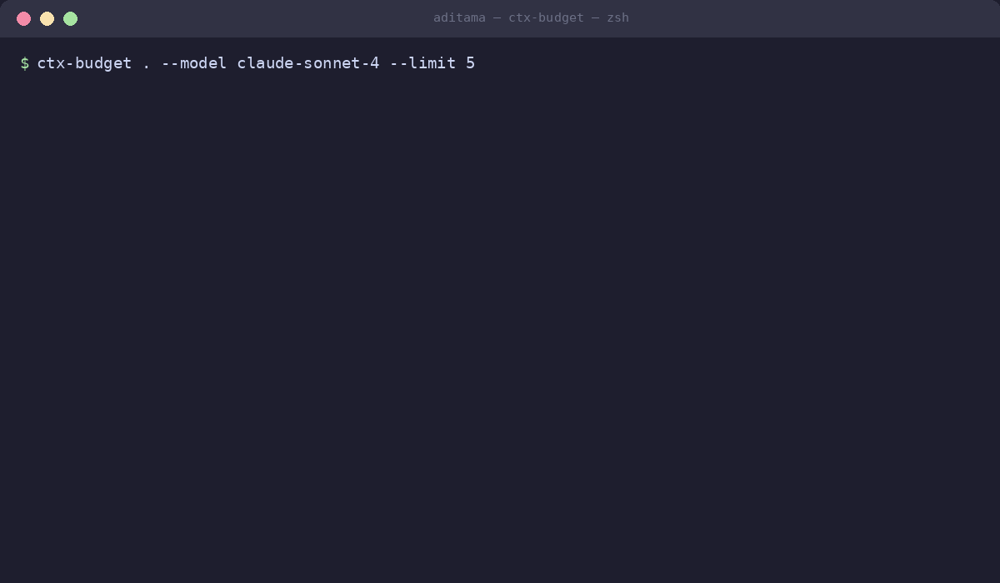

# ctx-budget

A Rust CLI for estimating token distribution across a codebase before choosing files for an LLM context window.

[](https://crates.io/crates/ctx-budget)
[](LICENSE)
[](https://github.com/tamaraw01/ctx-budget/actions/workflows/ci.yml)



The tool reads supported text files locally, ranks them by estimated tokens, and compares the total with a configured context window. It does not call a model API or upload file contents.

## Install

With Cargo:

```bash
cargo install ctx-budget
```

Or build from source:

```bash
git clone https://github.com/tamaraw01/ctx-budget
cd ctx-budget
cargo build --release
./target/release/ctx-budget --help
```

## Usage

```bash
# Scan the current directory; show the 10 largest files
ctx-budget . --limit 10 --output text

# Export every file, not just the default top 20
ctx-budget . --all --output json > tokens.json
ctx-budget . --all --output csv > tokens.csv

# Compare against a configured model window
ctx-budget /path/to/project --model gpt-4o

# Use your own model registry
ctx-budget . --models-path ./my-models.toml --model my-custom-model
```

The default output mode is `auto`: text in a terminal and JSON when piped. `--limit` and `--all` control the file list in all output formats; summary totals still cover the full scan.

## File selection

- Recognizes extensions for Rust, Python, JavaScript, TypeScript, Go, C/C++, and other languages, plus common text and configuration formats.
- Skips common dependency and build directory names, including `node_modules`, `.git`, `target`, `.venv`, `vendor`, `dist`, and `build`.
- Skips hidden filenames unless you pass `--hidden`. This is not a blanket exclusion of hidden directories.
- Skips symlinks, unsupported file types, and files it cannot read as UTF-8.

`--exclude-dirs` accepts comma-separated directory component names. Supplying it replaces the default exclusion list, so include any defaults you still need:

```bash
ctx-budget . --exclude-dirs "node_modules,.git,target,__pycache__,.venv,vendor,dist,build,coverage,generated"
```

The scanner does not use `.gitignore` rules. Review the selected files before using a report to assemble a prompt.

## Model configuration

The binary embeds [models.toml](models.toml). An explicit `--models-path` takes precedence; otherwise, the tool checks the current directory and the runtime `CARGO_MANIFEST_DIR` environment variable before using the embedded registry. An unreadable or invalid external registry produces a warning and falls back to the embedded data.

The CLI defaults to the registry ID `gpt-6-astra`. Treat bundled model names, windows, release dates, and prices as configuration data, not verified provider specifications. Check your provider's documentation and supply a current registry for planning actual requests.

A custom registry uses this structure (illustrative values):

```toml
[models.my-custom-model]
name = "My Custom Model"
provider = "Custom"
context_window = 500000
max_output = 128000
input_price_per_1m = 1.00
output_price_per_1m = 5.00
released = "2026-09-12"
description = "Your model description here"
```

The report compares the scan total with `context_window`. It does not reserve `max_output`, calculate API cost, or account for system prompts, conversation history, and message-format overhead. Leave room for those separately.

## Estimation and limits

For each file, the estimator averages two integer-truncated values:

1. Whitespace-separated word count multiplied by 1.3.
2. UTF-8 byte length divided by 4.

This is a heuristic, not a model tokenizer or GPT-2 BPE implementation. The report field named `chars` also measures UTF-8 bytes, which differs from character count for non-ASCII text. Validate a final prompt with the target model's tokenizer when exact limits matter.

Each file is read into memory in full, and the tool retains per-file report records before sorting. It is not a streaming file tokenizer.

## Development

The integration tests invoke `./target/release/ctx-budget`, so build the release binary before running them:

```bash
cargo build --release
cargo test --release
cargo fmt --check
```

See [CONTRIBUTING.md](CONTRIBUTING.md) for contribution guidelines.

## License

GNU General Public License v3.0 (GPL-3.0). See [LICENSE](LICENSE).
